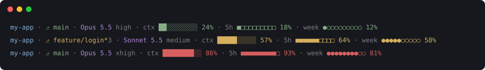
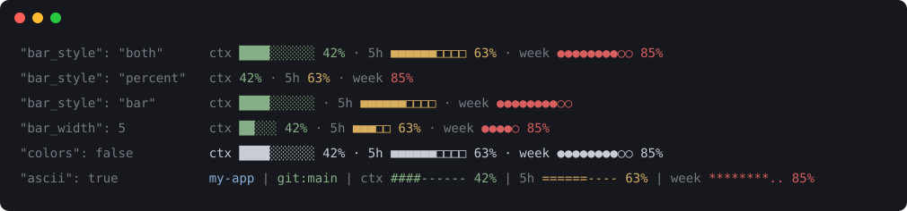
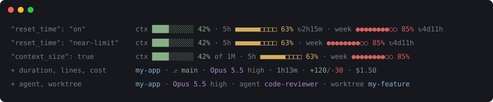
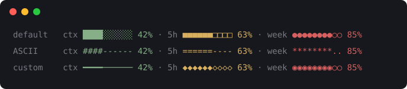

# Statuslines

A compact status line for [Claude Code](https://github.com/anthropics/claude-code) that shows how full your context window is and how much of your 5-hour and weekly limits you've used, so you don't have to keep opening the usage page.



Three bars side by side are easy to mix up, so each one has its own shape: **blocks** for context, **squares** for the 5-hour limit and **dots** for the weekly limit.

## What it shows

| Part | Example | What it means |
| --- | --- | --- |
| Folder | `my-app` | The folder Claude Code is working in |
| Branch | `⎇ main` | Your git branch. It turns yellow with a count, like `⎇ main*3`, when you have uncommitted changes |
| Model | `Opus 5.5 high` | The model and its effort level |
| Context | `ctx ██░░░░░░░░ 24%` | How full the context window is |
| 5-hour limit | `5h ■■■■■■□□□□ 64%` | How much of your 5-hour usage limit you've used |
| Weekly limit | `week ●●●●●○○○○○ 58%` | How much of your weekly usage limit you've used |

Bars are green below 50%, yellow from 50% and red from 80%.

All of it can be changed: hide or reorder any part, show percentages without bars, add the session time, lines changed, cost or reset times, and more. See [Customize](#customize).

## Install

In Claude Code, run these one at a time:

```
/plugin marketplace add Chy-Zaber-Bin-Zahid/claude-code-statusline
/plugin install statuslines@statuslines
```

Choose where to install it when asked (User is the default). Then turn it on:

```
/statuslines:setup
```

The new status line appears after your next message. If Claude Code says the setup command doesn't exist yet, run `/reload-plugins` and try again. Until setup is done, each new session starts with a reminder to run it.

Mind the **s** at the end of `statuslines`. Without it you get a different plugin, `statusline`, from Claude Code's plugin directory, and plain `/statusline` is Claude Code's own built-in command.

On newer versions of Claude Code you can install it in one line instead:

```
/plugin install statuslines --marketplace Chy-Zaber-Bin-Zahid/claude-code-statusline
```

If Claude Code doesn't recognize `/plugin`, update it first with `claude update`.

<details>
<summary>Without the plugin system</summary>

Download the script:

```bash
curl -fsSL https://raw.githubusercontent.com/Chy-Zaber-Bin-Zahid/claude-code-statusline/main/statusline.sh -o ~/.claude/statusline-plugin.sh
```

Then add this to `~/.claude/settings.json`:

```json
{
  "statusLine": {
    "type": "command",
    "command": "bash ~/.claude/statusline-plugin.sh"
  }
}
```

</details>

## Customize

Tell Claude what you want, in your own words:

```
/statuslines:configure percent only, hide the git branch
/statuslines:configure turn on session cost and reset times
/statuslines:configure reset to defaults
```

Or edit `~/.claude/statusline-plugin.json` yourself. Every key is optional, and changes show up after your next message. For example, this shows percentages only, hides the branch and adds the session cost:

```json
{
  "parts": ["folder", "model", "context", "five_hour", "weekly", "cost"],
  "bar_style": "percent"
}
```

```
my-app · Opus 5.5 high · ctx 42% · 5h 63% · week 85% · $1.50
```

| Option | Values | Default | What it does |
| --- | --- | --- | --- |
| `parts` | list of parts, see below | `["folder", "git", "model", "context", "five_hour", "weekly"]` | Which parts show, left to right. Leave one out to hide it |
| `bar_style` | `"both"`, `"percent"`, `"bar"` | `"both"` | Bar and percent, percent only, or bar only |
| `bar_width` | 1 to 40 | `10` | Number of cells in each bar |
| `effort` | `true`, `false` | `true` | Effort level after the model name |
| `labels` | `true`, `false` | `true` | The `ctx`, `5h` and `week` labels |
| `reset_time` | `"off"`, `"on"`, `"near-limit"` | `"off"` | Time until the 5-hour and weekly limits reset, like `↻2h15m`. `near-limit` shows it only once that bar turns red |
| `colors` | `true`, `false` | `true` | Plain text when `false` |
| `warn_at` | 0 to 101 | `50` | Percent where a bar turns yellow |
| `danger_at` | 0 to 101 | `80` | Percent where a bar turns red |
| `context_size` | `true`, `false` | `false` | The context window size after the context meter, like `42% of 1M` |
| `ascii` | `true`, `false` | `false` | Plain ASCII characters only, for terminals or fonts that can't draw the shapes |
| `shapes` | `{"weekly": ["#", "-"]}` | blocks, squares, dots | The filled and empty characters for each bar: `context`, `five_hour` or `weekly` |

The parts you can list are `folder`, `git`, `model`, `context`, `five_hour` and `weekly`, plus five that are off by default:

- `duration`: session time, like `1h13m`
- `lines`: lines added and removed, like `+120/-30`
- `cost`: session cost, like `$1.50`, once there is some
- `agent`: the agent's name, while you run Claude Code as an agent
- `worktree`: the worktree's name, while the session is in one

### Examples

Each line is labeled with the option that produces it.

**Bar styles, width, colors and ASCII**



**Reset times, context size and extra parts**



**Your own shapes**



The custom line above uses:

```json
{
  "shapes": {
    "context": ["━", "─"],
    "five_hour": ["◆", "◇"],
    "weekly": ["◉", "○"]
  }
}
```

## Requirements

- Claude Code
- `bash`, `jq` and `git` (git is only used for the branch)
- A Claude Pro or Max plan for the 5-hour and weekly bars. They appear once a session has had its first reply. With an API key or another provider, such as Bedrock, Vertex or GLM, Claude Code gets no usage numbers, so those bars stay hidden and the rest of the line still works.

Tested on macOS, including its built-in bash 3.2. It uses only standard tools, so it should work on Linux too. On Windows, use WSL.

## Update

```bash
claude plugin update statuslines@statuslines
```

Then run `/statuslines:setup` again so it copies the new version.

## Uninstall

1. Remove the `statusLine` entry from `~/.claude/settings.json`, or put your old one back.
2. Run `claude plugin uninstall statuslines@statuslines`.
3. Delete `~/.claude/statusline-plugin.sh`, and `~/.claude/statusline-plugin.json` if you made one.

## Speed and privacy

The status line refreshes often, so the script remembers the git check for 5 seconds. With that, each refresh takes about 50 ms.

The script runs on your computer and makes no network requests. It reads only the session data Claude Code passes to it and the git status of your current folder. The only thing it writes is that git answer, in one small file per session in your temp folder.

## License

[MIT](LICENSE). This is a community project. It isn't made by or affiliated with Anthropic.
